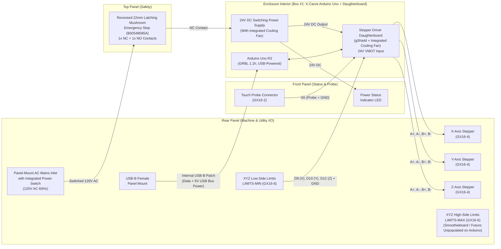

# Standardized CNC Controller Box Interface & X-Carve Enclosure Requirements (`REQ-CTRL`)

## 1. Purpose & Architectural Vision

This specification defines the **Standardized CNC Controller Box Interface** for workshop CNC machinery. The objective is to decouple the **CNC Motion Controller Box** from the **Physical CNC Machine Frame** (X-Carve 1000mm, future Smoothieboard CNC Router, or CNC Plasma Table) by establishing:
1. **Identical External Connectorization & Pinouts**: Any standardized controller box can be physically dropped in and plugged into any standardized CNC machine harness in the shop without rewiring connectors.
2. **Pin-Count Poka-Yoke (Mistake-Proofing)**: Using distinct pin configurations from the 16mm **GX16 circular metal aviation connector** family (`GX16-2`, `GX16-4`, `GX16-6`) so that low-voltage logic inputs (limit switches, touch probe) cannot be accidentally plugged into high-voltage $24\text{V DC}$ stepper motor outputs.
3. **Simplified Power & Control Topology**:
   - **Rear Switched AC Mains Inlet**: A single panel-mount AC power inlet with integrated main power switch controls primary power into the enclosure.
   - **USB-Powered Controller Logic**: The Arduino Uno motion controller is powered directly over the USB-B connection from the host (`voltron.local`), eliminating the need for an internal 5V step-down regulator or separate logic switch.
   - **Front Panel Status & Probe**: Front panel houses only the **Power Indicator LED** and the **Touch Probe (`GX16-2`)** connector.
   - **Top Recessed Emergency Stop**: A $22\text{ mm}$ latching mushroom E-Stop recessed into the top lid interrupts power immediately when pressed.

---

## 2. System Block & Power Distribution Architecture

---

## 3. Formal System Requirements (ISO/IEC/IEEE 29148 & EARS Syntax)

### 3.1 Physical Panel Topology & Ergonomics (`REQ-CTRL-PNL`)
- **`REQ-CTRL-PNL-01` (Ubiquitous — Rear Panel Interfaces)**: The CNC Controller Enclosure shall locate all permanent machine-harness and utility connections on the **Rear Panel**, comprising:
  1. One (1) AC Mains Power Inlet (`120V AC`, `60Hz`) with an integrated main power rocker switch,
  2. One (1) USB-B Female Panel-Mount Data & 5V Logic Power Port,
  3. Three (3) Stepper Motor Output Connectors (`X`, `Y`, `Z`),
  4. One (1) Combined XYZ Low-Side Limit Switch Connector (`LIMITS-LOW / MIN`), and
  5. One (1) Combined XYZ High-Side Limit Switch Connector (`LIMITS-HIGH / MAX` — wired on Smoothieboard/advanced controllers; unpopulated or omitted on low-side-only Arduino controllers).
- **`REQ-CTRL-PNL-02` (Ubiquitous — Front Panel Status & Probe)**: The CNC Controller Enclosure shall keep the **Front Panel** clean and uncluttered, comprising only:
  1. One (1) Power Status Indicator LED (with optional second status LED if desired), and
  2. One (1) XYZ/Z Touch Probe Connector (`GX16-2`).
- **`REQ-CTRL-PNL-03` (Ubiquitous — Recessed Top Panel Emergency Stop)**: The CNC Controller Enclosure shall mount one (1) $22\text{ mm}$ latching red mushroom-head Emergency Stop push button switch (`B00548585A`) inside a recessed well on the **Top Panel** such that the mushroom cap sits flush or near-flush with the top surface (preventing accidental snags) while leaving full finger clearance for palm actuation and twist-to-reset, without obstructing internal cooling airflow.

### 3.2 Standardized Connectorization & Pinout Interoperability (`REQ-CTRL-PIN`)
- **`REQ-CTRL-PIN-01` (Ubiquitous — Connector Family & Panel Gender Convention)**: All external low-voltage machine and sensor connections on the enclosure shall use $16\text{ mm}$ threaded metal circular aviation connectors (**GX16 series**).
- **`REQ-CTRL-PIN-02` (Ubiquitous — Pin-Count Poka-Yoke Keying)**: To prevent accidental cross-connection between high-voltage stepper driver outputs and 5V logic inputs, each functional signal class shall use a distinct GX16 pin count:
  - **Stepper Motors (`X`, `Y`, `Z`)**: **4-Pin GX16 (`GX16-4`)** (from Kit `B07F5B5LLX`)
  - **Combined XYZ Limit Switch Banks (`LIMITS-LOW` & `LIMITS-HIGH`)**: **6-Pin GX16 (`GX16-6`)** (from Kit `B07F5FJVHD`) *(giving each axis `X`, `Y`, `Z` its own dedicated `Signal + GND` pin pair so 3 ground wires never have to be spliced into a single solder cup)*
  - **Touch Probe (`PROBE`)**: **2-Pin GX16 (`GX16-2`)** (from Kit `B07F5B5LLX`)
- **`REQ-CTRL-PIN-03` (Ubiquitous — Standardized Stepper Motor Pinout)**: Every stepper motor port (`X`, `Y`, `Z` on `GX16-4`) across all interchangeable controller boxes shall enforce the following bipolar 2-phase pin assignment:
  - **Pin 1**: Coil A+ (`RED` / Phase A+)
  - **Pin 2**: Coil A- (`BLUE` or `GREEN` / Phase A-)
  - **Pin 3**: Coil B+ (`GREEN` or `YELLOW` / Phase B+)
  - **Pin 4**: Coil B- (`BLACK` / Phase B-)
- **`REQ-CTRL-PIN-04` (Ubiquitous — Standardized Combined XYZ Limit Switch Bank Pinout)**: Both the **Low-Side (`LIMITS-LOW / MIN`)** and **High-Side (`LIMITS-HIGH / MAX`)** `GX16-6` connectors shall enforce an identical 3-axis pin assignment across all interchangeable controller boxes:
  - **Pin 1**: **X-Axis Limit Signal** (`X_MIN`=`D9` on Arduino; `X_MIN` or `X_MAX` on Smoothieboard)
  - **Pin 2**: **X-Axis Limit Return (`GND`)**
  - **Pin 3**: **Y-Axis Limit Signal** (`Y_MIN`=`D10` on Arduino; `Y_MIN` or `Y_MAX` on Smoothieboard)
  - **Pin 4**: **Y-Axis Limit Return (`GND`)**
  - **Pin 5**: **Z-Axis Limit Signal** (`Z_MIN`=`D12` in Grbl 1.1 / `D11` in Grbl 0.9; `Z_MIN` or `Z_MAX` on Smoothieboard)
  - **Pin 6**: **Z-Axis Limit Return (`GND`)**
- **`REQ-CTRL-PIN-05` (Ubiquitous — Standardized Touch Probe Pinout)**: The front-panel Touch Probe port (`GX16-2`) shall enforce the following pin assignment:
  - **Pin 1**: Probe Sense Input (`A5` / Grbl `SCL` probe pin, pulled up to $+5\text{V}$ via internal pull-up and noise-filter capacitor)
  - **Pin 2**: Signal Ground (`GND` — connected to the crocodile clip / endmill body)

### 3.3 Power Architecture & Safety Interlocks (`REQ-CTRL-PWR`)
- **`REQ-CTRL-PWR-01` (Ubiquitous — USB-Powered Controller Logic)**: The motion controller MCU (Arduino Uno) shall receive $+5\text{V DC}$ operating power directly over the internal USB-B patch cable from the rear USB-B panel mount connected to the host (`voltron.local`).
- **`REQ-CTRL-PWR-02` (State-Driven — Switched 24V Motor & Cooling Supply)**: While the Rear AC Inlet Power Switch is `ON` and the Top Emergency Stop is unlatched (`NC` closed), the $24\text{V DC}$ power supply shall energize the stepper driver daughterboard (`24V VMOT`), cooling fans, and the front-panel Power Status Indicator LED.
- **`REQ-CTRL-PWR-03` (State-Driven — Safe Dry-Run / Config Inspection Mode)**: While the USB host is connected and the Rear AC Inlet Power Switch is `OFF`, the Arduino controller shall remain powered over USB for Grbl configuration (`$$`), status queries (`?`), and limit/probe switch testing with zero $24\text{V}$ power applied to the stepper motors.
- **`REQ-CTRL-PWR-04` (Event-Driven — Emergency Stop Actuation)**: When the Top-Panel Latching Mushroom Emergency Stop button is pressed, the Normally Closed (`NC`) contact block shall immediately interrupt power to the $24\text{V}$ power supply (de-energizing stepper motors) and remain mechanically latched until manually twisted to reset.

### 3.4 Thermal, EMI & Mechanical Enclosure Requirements (`REQ-CTRL-ENC`)
- **`REQ-CTRL-ENC-01` (Ubiquitous — Forced-Air Ventilation & Cross-Flow Alignment)**: Because both the stepper motor controller assembly and the $24\text{V DC}$ power supply incorporate their own forced-air cooling fans, the 3D-printed enclosure shall provide high-free-area intake and exhaust ventilation grilles/louvers aligned with both fans to cycle fresh ambient air through the case and exhaust heated air directly outside without internal recirculation or thermal throttling.
- **`REQ-CTRL-ENC-02` (Ubiquitous — Serviceable Lid & Split Harness Access)**: The enclosure shall be removable/openable for inspection without unsoldering panel-mount components (using internal spade terminals, screw terminals, or inline disconnects).

---

## 4. Standardized Connector & Pinout Reference Table

| Panel | Port Label | Connector Type | Pin 1 | Pin 2 | Pin 3 | Pin 4 | Pin 5 | Pin 6 | Target (Arduino Box vs. Smoothieboard Box) |
| :---: | :---: | :--- | :--- | :--- | :--- | :--- | :--- | :--- | :--- |
| **Rear** | **`X-MOTOR`** | `GX16-4` (4-Pin) | Coil `A+` | Coil `A-` | Coil `B+` | Coil `B-` | — | — | Stepper Driver `X` |
| **Rear** | **`Y-MOTOR`** | `GX16-4` (4-Pin) | Coil `A+` | Coil `A-` | Coil `B+` | Coil `B-` | — | — | Stepper Driver `Y` *(Note 1)* |
| **Rear** | **`Z-MOTOR`** | `GX16-4` (4-Pin) | Coil `A+` | Coil `A-` | Coil `B+` | Coil `B-` | — | — | Stepper Driver `Z` |
| **Rear** | **`LIMITS-LOW`** | `GX16-6` (6-Pin) | `X_MIN_SIG` | `X_GND` | `Y_MIN_SIG` | `Y_GND` | `Z_MIN_SIG` | `Z_GND` | **Arduino**: `D9`, `D10`, `D12` + `GND` **Smoothie**: `alpha_min`, `beta_min`, `gamma_min` |
| **Rear** | **`LIMITS-HIGH`** | `GX16-6` (6-Pin) | `X_MAX_SIG` | `X_GND` | `Y_MAX_SIG` | `Y_GND` | `Z_MAX_SIG` | `Z_GND` | **Arduino**: *Unconnected / Dummy Receptacle* **Smoothie**: `alpha_max`, `beta_max`, `gamma_max` |
| **Rear** | **`USB`** | USB-B Panel | `VBUS (+5V)` | `D-` | `D+` | `GND` | — | — | Controller USB-B Port (Data + 5V Power) |
| **Rear** | **`AC MAINS`** | Switched IEC C14 Inlet | `Line (Hot)` | `Neutral` | `Earth GND` | — | — | — | Integrated Switch $\rightarrow$ Top E-Stop (`NC`) $\rightarrow$ 24V PSU |
| **Front** | **`PROBE`** | `GX16-2` (2-Pin) | `PROBE_SIG` | `GND` | — | — | — | — | **Arduino**: `A5` (`SCL`) + `GND` **Smoothie**: `zprobe.probe_pin` (`1.28`) |
| **Front** | **`PWR LED`** | Panel Indicator LED | `+24V` (via R) | `GND` | — | — | — | — | Illuminates when 24V PSU is energized |
| **Top** | **`E-STOP`** | 22mm (`B00548585A`) | `NC-1` | `NC-2` | `NO-1` *(opt)* | `NO-2` | — | — | Primary Power Cutoff (Recessed Well) |

> [!NOTE]
> **Note 1 — X-Carve Dual Y-Axis Stepper Wiring**: On the X-Carve 1000mm, the two Y-axis stepper motors (`Y1` Left and `Y2` Right) are wired in parallel with one coil pair reversed at the gantry terminal block so they drive the gantry in unison from the single `Y` driver channel on the gShield. Bringing a single **`Y-MOTOR` (`GX16-4`)** connector out the back of the controller box preserves full compatibility with both single-driver ganged Y machines and external Y-splitter harnesses.

---

## 5. Shop Parts Inventory & Measurement Checklist (Pre-CAD Intake)

### 5.1 Confirmed On-Hand Components (Known Specs)
| # | Component Type | Status / Reference | Key Mounting / CAD Dimension |
| :---: | :--- | :--- | :--- |
| **1** | **GX16-4 Aviation Connectors (3 Pairs: X, Y, Z Steppers)** | On Hand ([`B07F5B5LLX`](https://www.amazon.com/dp/B07F5B5LLX)) | **$16.0\text{ mm}$** circular panel cutout (Rear Panel $\times 3$) |
| **2** | **GX16-6 Aviation Connectors (1 Pair Low-Side + Optional 1 Pair High-Side)** | On Hand ([`B07F5FJVHD`](https://www.amazon.com/dp/B07F5FJVHD)) | **$16.0\text{ mm}$** circular panel cutout (Rear Panel $\times 1$ or $\times 2$) |
| **3** | **GX16-2 Aviation Connector (1 Pair: Front Touch Probe)** | On Hand ([`B07F5B5LLX`](https://www.amazon.com/dp/B07F5B5LLX)) | **$16.0\text{ mm}$** circular panel cutout (Front Panel $\times 1$) |
| **4** | **22mm Red Mushroom Latching Emergency Stop Switch** | On Hand ([`B00548585A`](https://www.amazon.com/dp/B00548585A)) | **$22.0\text{ mm}$** circular hole in recessed top well (Top Panel $\times 1$) |

### 5.2 Parts to Locate in Shop & Measure Before Enclosure CAD
| # | Generic Part Type Needed | Quantity | Purpose / Notes | Measurements Needed From Your Stock |
| :---: | :--- | :---: | :--- | :--- |
| **5** | **Switched 120V AC Wall Power Inlet** *(IEC C14 Socket with Built-In Rocker Switch)* | 1 | Rear Panel 120V AC power entry + master ON/OFF switch | Panel cutout `Width × Height (mm)`, screw hole spacing (`mm`), and internal depth |
| **6** | **USB-B Female Panel-Mount to USB-B Male Internal Patch Cable** | 1 | Rear Panel USB-B socket to internal Arduino Uno USB-B jack (carries Data + 5V USB power) | Panel cutout dimensions + mounting screw spacing (`mm`, typically ~`28–30mm` center-to-center) + cable length |
| **7** | **Panel-Mount Power Indicator LED** | 1 *(or 2)* | Front Panel: `24V Power ON` indicator | Mounting hole diameter (e.g., `6mm`, `8mm`, `10mm`, or `12mm`) and rated LED voltage (`24V`, `12V`, `5V`, or raw `2V` LED) |
| **8** | **24V DC Switching Power Supply** *(Existing X-Carve PSU with integrated fan)* | 1 | Primary $120\text{V AC} \rightarrow 24\text{V DC}$ supply | `Length × Width × Height (mm)`, mounting hole spacing, and **fan position & airflow direction** |
| **9** | **Arduino Uno + Motor Daughterboard + Cooling Fan Assembly** *(Existing X-Carve)* | 1 | Motion controller stack (`68.6 × 53.3 mm` Uno base) + daughterboard + fan | Total stack `L × W × H (mm)` including fan mount, plus **fan orientation & airflow direction** |
| **10** | **0.1 µF Ceramic Decoupling Capacitors (Optional / Recommended)** | 4 | Across `X_LIM`, `Y_LIM`, `Z_LIM`, and `PROBE` inputs to `GND` inside the box to eliminate false EMI limit triggers | Standard through-hole or inline across screw/pin terminals |
| **11** | **Internal Hookup Wire & Spade / Crimp Terminals** | Assorted | 16–18 AWG (AC/24V/Steppers), 20–22 AWG (Limits/Probe), female quick-disconnects for AC inlet & E-Stop | Standard shop wire & heat-shrink tubing |

---

## 6. Requirements Traceability Matrix (RTM)

| Requirement ID | Category | Summary | Verification Method | Target Artifact / Verification Phase |
| :---: | :---: | :--- | :---: | :--- |
| `REQ-CTRL-PNL-01` | Panel Layout | Rear panel houses Switched AC Inlet, USB-B, 3× Stepper (`GX16-4`), `LIMITS-LOW` & `LIMITS-HIGH` (`GX16-6`) | Inspection (`I`) | Phase 2 CAD Model & Physical Panel Check |
| `REQ-CTRL-PNL-02` | Panel Layout | Front panel houses Power Indicator LED and 1× Touch Probe (`GX16-2`) | Inspection (`I`) | Phase 2 CAD Model & Physical Panel Check |
| `REQ-CTRL-PNL-03` | Panel Layout | Top panel houses Recessed 22mm Latching Mushroom E-Stop (`B00548585A`) | Inspection (`I`) | Phase 2 CAD Model & Physical Panel Check |
| `REQ-CTRL-PIN-01` | Connector Std | All low-voltage external machine/probe ports use 16mm `GX16` aviation connectors | Inspection (`I`) | Section 4 Pinout Standard & Harness Build |
| `REQ-CTRL-PIN-02` | Poka-Yoke | Distinct pin counts: `GX16-4` (Steppers), `GX16-6` (Limit Banks), `GX16-2` (Probe) | Inspection (`I`) | Section 4 Pinout Standard & Harness Build |
| `REQ-CTRL-PIN-03` | Stepper Pinout | Standardized `1:A+, 2:A-, 3:B+, 4:B-` pinout across all `GX16-4` ports | Test (`T`) / Multimeter | Continuity & Phase Polarity Bench Check |
| `REQ-CTRL-PIN-04` | Limit Bank Pinout | Standardized 6-pin `1-2:X, 3-4:Y, 5-6:Z` (`SIG+GND`) on `LIMITS-LOW` & `LIMITS-HIGH` (`GX16-6`) | Test (`T`) / `?` Status | Grbl `?` `Pn:XYZ` Trigger Verification |
| `REQ-CTRL-PIN-05` | Probe Pinout | Standardized `1:PROBE(A5), 2:GND` pinout on Front `GX16-2` port | Test (`T`) / `?` Status | Grbl `?` `Pn:P` Trigger Verification |
| `REQ-CTRL-PWR-01` | USB Logic Power | Arduino powered directly over USB-B connection from host (`voltron.local`) | Demonstration (`D`) | Plug USB into `voltron.local` $\rightarrow$ Grbl responds to `?` |
| `REQ-CTRL-PWR-02` | Switched 24V | Rear Switched AC Inlet + Top E-Stop energizes 24V PSU, `VMOT`, fans, and Front Power LED | Test (`T`) / Multimeter | Flip rear switch `ON` $\rightarrow$ $24.0\text{V DC}$ at `VMOT` & Front LED ON |
| `REQ-CTRL-PWR-03` | Dry-Run Mode | Controller runs on USB with Rear AC Switch `OFF` (motors de-energized) | Demonstration (`D`) | Query Grbl `$$` and test switches with Rear Switch `OFF` |
| `REQ-CTRL-PWR-04` | Emergency Stop | Top Recessed 22mm E-Stop immediately cuts primary power & latches until twisted | Demonstration (`D`) | Press E-Stop under power $\rightarrow$ full immediate de-energization |
| `REQ-CTRL-ENC-01` | Thermal | Enclosure intake/exhaust grilles aligned with PSU and motor controller forced-air fans | Inspection (`I`) | CAD Airflow Grille Alignment Check |
| `REQ-CTRL-ENC-02` | Serviceability | Lid/panel opens for service without unsoldering panel connectors | Inspection (`I`) | CAD Assembly & Internal Harness Design |
