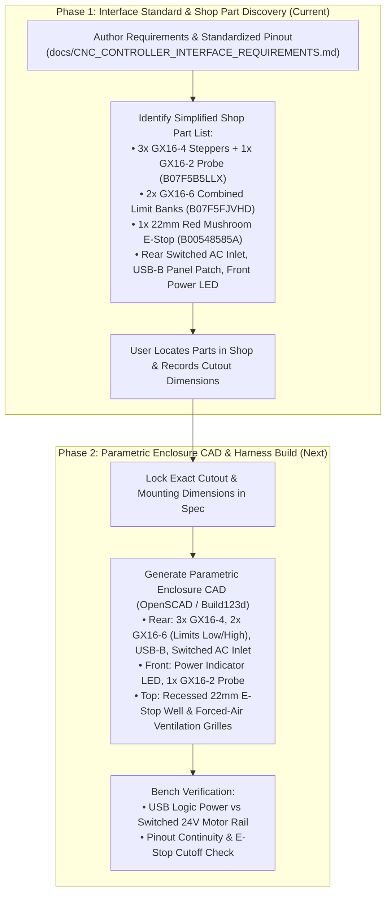

# Plan 11: Standardized CNC Controller Box Interface, Pinout Specification & X-Carve Arduino Enclosure

## 1. Goal Description
Establish a **Standardized CNC Controller Box Interface** so that any CNC motion controller enclosure in the workshop (starting with the existing **X-Carve Arduino Uno + Stepper Daughterboard + 24V Power Supply** box, and extending to future **Smoothieboard 32-bit** or **CNC Plasma** controller boxes) uses an identical external connector family, pinout convention, and operator control layout.

### Problem Statement & Objectives:
1. **Interchangeable CNC Controller Boxes**: Standardize the rear machine panel (`GX16-4` steppers, `GX16-6` combined `LIMITS-LOW` and `LIMITS-HIGH` banks, panel-mount `USB-B`, and switched `120V AC` mains inlet), front panel (`Power Status LED` and `GX16-2` `Touch Probe` port), and top panel (recessed `22mm` latching mushroom `Emergency Stop`), so any controller box can be plugged into any standardized CNC machine in the shop.
2. **Simplified Power & Control Topology**:
   - **Rear Switched AC Mains Inlet**: Use a panel-mount AC power plug with a built-in master switch on the rear panel to control primary power to the 24V power supply (no front rocker switches needed).
   - **USB-Powered Controller Logic**: Power the Arduino Uno directly over the USB-B connection from `voltron.local` (no internal 5V buck converter block required).
   - **Forced-Air Ventilation Alignment**: Design the 3D-printed enclosure with intake and exhaust ventilation grilles aligned with the existing forced-air cooling fans on the 24V power supply and motor controller assembly, plus a recessed top well for the 22mm mushroom E-Stop.
3. **Two-Phase Execution (Requirements & Shop Part Discovery $\rightarrow$ Parametric Enclosure CAD)**:
   - **Phase 1 (Current)**: Document formal ISO 29148 / EARS system requirements (`REQ-CTRL-PNL`, `REQ-CTRL-PIN`, `REQ-CTRL-PWR`, `REQ-CTRL-ENC`), standardized GX16 pinout tables, internal wiring architecture, and the simplified shop part-type checklist in [`docs/CNC_CONTROLLER_INTERFACE_REQUIREMENTS.md`](../CNC_CONTROLLER_INTERFACE_REQUIREMENTS.md).
   - **Phase 2 (Next — After Shop Part Measurements)**: Once the user measures the switched AC inlet, front power LED, USB-B panel mount cable, 24V PSU, and Arduino + motor controller fan assembly, generate the parametric 3D-printable controller enclosure CAD model.

---

## 2. Architecture & Workflow Diagram



---

## 3. Code & Hardware Specifications

### Phase 1 Deliverables (Requirements, Pinout Standard & Part-Type Identification)
- `[NEW]` [`docs/CNC_CONTROLLER_INTERFACE_REQUIREMENTS.md`](../CNC_CONTROLLER_INTERFACE_REQUIREMENTS.md):
  - Complete system requirements (`REQ-CTRL-PNL-01`–`03`, `REQ-CTRL-PIN-01`–`05`, `REQ-CTRL-PWR-01`–`04`, `REQ-CTRL-ENC-01`–`02`) in ISO 29148 / EARS syntax.
  - Standardized Pinout Table for Rear (`X/Y/Z` `GX16-4`, `LIMITS-LOW` & `LIMITS-HIGH` `GX16-6`, `USB-B`, `Switched AC Mains`), Front (`PWR LED`, `PROBE` `GX16-2`), and Top (`Recessed 22mm E-Stop`).
  - Simplified Shop Part-Type & Measurement Checklist for user inventory lookup.
- `[NEW]` [`scripts/generate_controller_parts_worksheet_pdf.py`](../../scripts/generate_controller_parts_worksheet_pdf.py) & [`docs/CNC_Controller_Box_Shop_Parts_Worksheet.pdf`](../CNC_Controller_Box_Shop_Parts_Worksheet.pdf):
  - Printable 1-page Barn Shop Parts & Caliper Measurement Worksheet.
- `[MODIFY]` [`docs/plans/AGENTS.md`](AGENTS.md):
  - Register Plan `11` in the `Conversational-CNC-Controller` Master Plan Registry and Prioritized Active Execution Queue.
- `[MODIFY]` [`../../docs/plans/IDEAS.md`](../../../docs/plans/IDEAS.md):
  - Cross-reference the Standardized CNC Controller Box Interface (`Plan 11`) under the `Smoothieboard Variable-Speed Spindle CNC Router Machine` backlog entry.

### Phase 2 Deliverables (Pending User Shop Part Measurements)
- `[NEW]` `hardware/cad/cnc_controller_enclosure.scad` (or `hardware/cad/cnc_controller_enclosure.py`):
  - Parametric enclosure and ventilated lid CAD files sized to the exact 24V PSU, Arduino Uno + daughterboard + fan stack, switched AC inlet cutout, indicator LED hole, $16\text{ mm}$ GX16 cutouts, and recessed $22\text{ mm}$ top E-Stop well.

---

## 4. Test Updates & Specifications

### Phase 1 Verification (Requirements & Link Hygiene)
1. **Requirements Quality & EARS Compliance Inspection**:
   - Verify all `REQ-CTRL-*` statements in [`docs/CNC_CONTROLLER_INTERFACE_REQUIREMENTS.md`](../CNC_CONTROLLER_INTERFACE_REQUIREMENTS.md) are atomic, unambiguous, and mapped in the Requirements Traceability Matrix (RTM).
2. **Markdown Link & Path Hygiene Verification**:
   - Verify zero hardcoded machine paths and 100% valid relative links across [`docs/CNC_CONTROLLER_INTERFACE_REQUIREMENTS.md`](../CNC_CONTROLLER_INTERFACE_REQUIREMENTS.md), [`docs/plans/AGENTS.md`](AGENTS.md), and [`../../docs/plans/IDEAS.md`](../../../docs/plans/IDEAS.md).

### Phase 2 Verification (CAD Geometry & Electrical Bench Protocol — After Part Measurements)
1. **CAD Dimensional & Cutout Assertions**:
   - Verify $16.0\text{ mm}$ panel cutouts for all `GX16` connectors (`3× GX16-4` steppers, `2× GX16-6` Low/High limit banks, `1× GX16-2` probe).
   - Verify recessed $22.0\text{ mm}$ top panel well for the `B00548585A` mushroom E-Stop switch and aligned intake/exhaust grilles for the PSU and motor controller fans.
2. **Electrical Bench Checkout**:
   - Verify USB connection to `voltron.local` powers the Arduino Uno when the rear AC switch is `OFF` (safe config/switch test mode).
   - Verify flipping the rear AC switch `ON` energizes the 24V PSU, stepper daughterboard (`24V VMOT`), cooling fans, and front Power LED, and pressing the top E-Stop cuts 24V power immediately.

---

## 5. Documentation Updates
- `[NEW]` [`docs/CNC_CONTROLLER_INTERFACE_REQUIREMENTS.md`](../CNC_CONTROLLER_INTERFACE_REQUIREMENTS.md): Authoritative Standardized CNC Controller Box Interface Specification, Wiring Diagram, Pinout Standard, and Shop Part-Type Intake Checklist.
- `[NEW]` [`docs/CNC_Controller_Box_Shop_Parts_Worksheet.pdf`](../CNC_Controller_Box_Shop_Parts_Worksheet.pdf): Printable 1-page Barn Parts & Caliper Measurement Worksheet.
- `[MODIFY]` [`docs/plans/AGENTS.md`](AGENTS.md): Register Plan `11`.
- `[MODIFY]` [`../../docs/plans/IDEAS.md`](../../../docs/plans/IDEAS.md): Link future Smoothieboard CNC controller build to the Standardized CNC Controller Interface (`Plan 11`).

---

## 6. Verification Plan

### Automated Verification (Phase 1 — Documentation Gate per Invariant 14):
```bash
# Verify zero broken links or hardcoded machine paths in updated docs
python3 scripts/audit_security_and_hygiene.py
```

### Manual Verification (Phase 1 -> Phase 2 Handoff):
1. Review the simplified Standardized Pinout Table (Section 4) and Shop Parts Inventory Checklist (Section 5.2) in [`docs/CNC_CONTROLLER_INTERFACE_REQUIREMENTS.md`](../CNC_CONTROLLER_INTERFACE_REQUIREMENTS.md).
2. Pull the 5 items from shop stock (Switched AC Inlet, USB-B Panel Mount Cable, Front Power LED, 24V PSU, and Arduino + Motor Controller stack) and share their measurements so we can proceed to Phase 2 enclosure CAD design.
