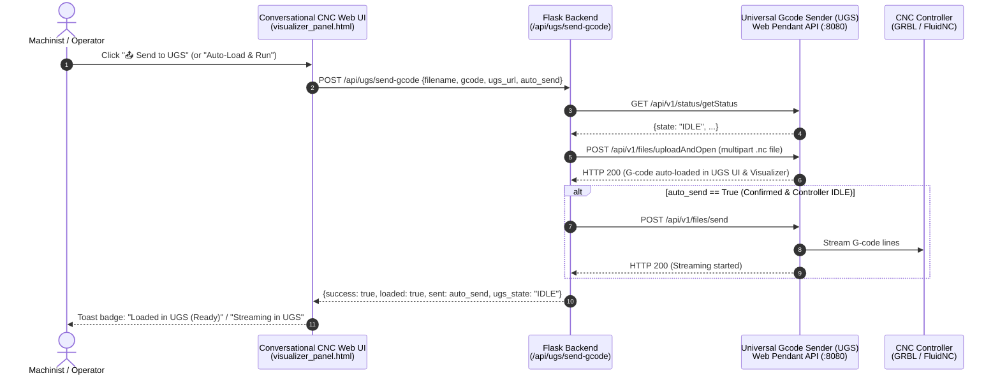

# Plan 12: Direct Universal Gcode Sender (UGS) Integration — 1-Click Auto-Load & Optional Auto-Send

## 1. Goal Description

### Problem Statement & Context
Currently, running a generated G-code program from `Conversational-CNC-Controller` requires a multi-step manual workflow:
1. Generate the G-code in the web UI (`http://voltron.local`).
2. Click **Download `.nc`** to save the file to disk.
3. Switch to **Universal Gcode Sender (UGS)**, click **File -> Open**, browse to the downloaded `.nc` file, and then click **Send**.

Rather than reinventing a custom serial sender, Universal Gcode Sender (UGS Platform / UGS Classic with Web Pendant enabled) natively exposes a built-in **Web Pendant REST API** (default port `:8080`):
- `GET /api/v1/status/getStatus` — Queries UGS connection state (`DISCONNECTED`, `IDLE`, `RUN`, `HOLD`, `ALARM`), active coordinates, and loaded file name.
- `POST /api/v1/files/uploadAndOpen` — Accepts a `multipart/form-data` G-code file (`file` field), writes it to UGS's temp workspace, and **immediately loads and renders it inside the UGS desktop application and visualizer**.
- `POST /api/v1/files/send` — Starts streaming the currently loaded G-code program to the connected CNC controller (when UGS is in `IDLE` state).

### Objectives
1. **UGS Pendant Client & Proxy API (`backend/app/api/ugs.py`)**:
   - Add a backend integration module and Flask blueprint (`/api/ugs/status`, `/api/ugs/send-gcode`) that connects to a configurable UGS Web Pendant URL (default `http://127.0.0.1:8080` or the operator's shop laptop IP configured in Machine Profile / UI settings).
   - Provide **both** server-side proxy dispatch (for when UGS runs on `voltron.local` or a reachable LAN IP) **and** direct browser-to-localhost (`http://127.0.0.1:8080`) fallback so a laptop browser viewing `http://voltron.local` can push G-code directly to the UGS instance running on that same laptop!
2. **1-Click "Send to UGS (Auto-Load)" & Optional "Auto-Run in UGS" Controls**:
   - In [`backend/app/templates/components/visualizer_panel.html`](../../backend/app/templates/components/visualizer_panel.html) and [`backend/app/templates/components/job_builder_drawer.html`](../../backend/app/templates/components/job_builder_drawer.html), add a **"📤 Send to UGS"** button alongside the Download `.nc` button, plus an explicit, safety-interlocked **"▶️ Auto-Start Job in UGS"** toggle/confirmation modal.
3. **Safety Interlocks for Optional `Auto-Send`**:
   - **Auto-Load (`auto_send=False`, Default)**: Always safe — uploads and opens the `.nc` file in UGS (`POST /api/v1/files/uploadAndOpen`) so it immediately appears in the UGS visualizer ready to run.
   - **Auto-Send (`auto_send=True`, Opt-In)**:
     - Verifies the G-code passed all `WorkEnvelope` bounds checks (no `FAILED` envelope state).
     - Queries UGS `/api/v1/status/getStatus` to verify the controller is connected and in `IDLE` state (aborting if `ALARM`, `RUN`, or `DISCONNECTED`).
     - Requires an explicit operator confirmation dialog before invoking `POST /api/v1/files/send`.

---

## 2. Architecture & Workflow Diagram



---

## 3. Code Modifications

### Component 1: UGS Integration Blueprint & Client (`backend/app/api/ugs.py`)
- **`[NEW]`** `backend/app/api/ugs.py`:
  - `check_ugs_status(ugs_url: str) -> dict`: Calls `GET {ugs_url}/api/v1/status/getStatus` (timeout `2.5s`) and normalizes connection status (`online`, `state`, `active_file`, `work_coord`).
  - `push_gcode_to_ugs(ugs_url: str, filename: str, gcode: str, auto_send: bool = False) -> dict`:
    - Validates `gcode` is non-empty and sanitizes `filename` (`*.nc` / `*.gcode`).
    - When `auto_send=True`, first queries `check_ugs_status(ugs_url)` and rejects with HTTP `409 Conflict` if UGS state is not `IDLE`.
    - Uploads the G-code payload via `multipart/form-data` (`files={"file": (filename, gcode.encode("utf-8"), "text/plain")}`) to `POST {ugs_url}/api/v1/files/uploadAndOpen`.
    - If `auto_send=True`, calls `POST {ugs_url}/api/v1/files/send`.
  - Routes:
    - `GET /api/ugs/status`
    - `POST /api/ugs/send-gcode`
- **`[MODIFY]`** [`backend/app/__init__.py`](../../backend/app/__init__.py):
  - Register `ugs_bp` under `/api/ugs`.

### Component 2: Visualizer Panel & Job Builder UI (`visualizer_panel.html` & `api.js`)
- **`[MODIFY]`** [`backend/app/templates/components/visualizer_panel.html`](../../backend/app/templates/components/visualizer_panel.html):
  - Add **"📤 Send to UGS"** button, UGS target URL config popover (defaulting to `http://127.0.0.1:8080` with `localStorage` persistence), and optional **"Auto-Send after load"** checkbox with safety confirmation modal.
- **`[MODIFY]`** [`backend/app/templates/components/job_builder_drawer.html`](../../backend/app/templates/components/job_builder_drawer.html):
  - Add **"📤 Send Sequence to UGS"** action button in the multi-operation sequencer drawer.
- **`[MODIFY]`** [`backend/app/static/js/api.js`](../../backend/app/static/js/api.js):
  - Add `sendGcodeToUgs(filename, gcode, autoSend)` helper (trying `/api/ugs/send-gcode` and supporting direct client-side `fetch` when UGS runs on the client laptop's `127.0.0.1:8080`).

---

## 4. Test Updates & Specifications

- **`[NEW]`** `backend/tests/test_ugs_integration.py`:
  1. `test_ugs_status_endpoint_online_and_offline(monkeypatch, client)`: Verifies `GET /api/ugs/status` parses UGS `/api/v1/status/getStatus` when online and returns graceful `{online: False}` when UGS is closed.
  2. `test_send_gcode_to_ugs_autoload_only(monkeypatch, client)`: Verifies `POST /api/ugs/send-gcode` (`auto_send=False`) posts multipart `.nc` content to `/api/v1/files/uploadAndOpen` and does **not** call `/api/v1/files/send`.
  3. `test_send_gcode_to_ugs_with_autosend_when_idle(monkeypatch, client)`: Verifies `auto_send=True` verifies `state == "IDLE"`, calls `/api/v1/files/uploadAndOpen`, and then invokes `/api/v1/files/send`.
  4. `test_send_gcode_to_ugs_autosend_aborts_when_not_idle(monkeypatch, client)`: Verifies `auto_send=True` refuses to call `/api/v1/files/send` (returning HTTP `409`) if UGS reports `ALARM`, `RUN`, or `DISCONNECTED`.

---

## 5. Documentation Updates

- **`[MODIFY]`** [`docs/MACHINE_INTEGRATION_TEST_PLAN.md`](../MACHINE_INTEGRATION_TEST_PLAN.md):
  - Document how to enable the UGS Web Pendant (`Tools -> Start Pendant Server` on port `8080` in UGS) and use the 1-click **Send to UGS** workflow.

---

## 6. Verification Plan

### Automated Tests
```bash
./Conversational-CNC-Controller/run_tests.sh
```

### Manual Verification
1. Open Universal Gcode Sender (UGS) and start the Web Pendant (`Tools -> Start Pendant Server`, default `:8080`).
2. Generate any operation in `Conversational-CNC-Controller` and click **"📤 Send to UGS"**.
3. Confirm the G-code automatically loads into UGS and renders in the UGS 3D visualizer without downloading or opening files manually.
