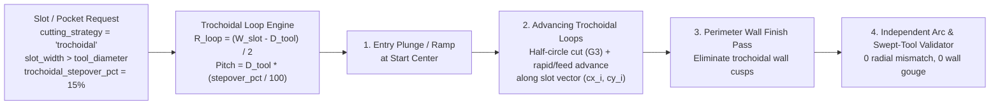

# Plan 13: Adaptive Trochoidal Clearing for Slotting & Pocketing

## 1. Goal Description

### Problem Statement & Context
Currently, `generate_linear_slot()` and `generate_arc_slot()` in [`backend/app/generators/slotting.py`](../../backend/app/generators/slotting.py) (as well as the initial opening cut of [`backend/app/generators/rectangular_pocket.py`](../../backend/app/generators/rectangular_pocket.py)) plunge and plow straight down the slot centerline at **100% radial cutter engagement**.

On workshop gantry CNCs (such as the X-Carve or leadscrew routers) cutting **brass, aluminum, or dense hardwood**:
- 100% radial engagement causes severe tool deflection, chatter, heat buildup, and chip recutting, frequently snapping small-diameter endmills (e.g. $1/8"$ / $3.175\text{ mm}$ or $1/16"$).
- Operators are forced to take ultra-shallow axial stepdowns ($0.2\text{--}0.4\text{ mm}$), which concentrates wear on the very tip of the flutes.

**Trochoidal ("Peel") Milling** solves this deterministically by replacing a full-width linear plow with a continuous series of overlapping circular arcs (`G2`/`G3` trochoidal loops) advancing along the slot centerline by a controlled radial stepover ($w_e$, typically $10\%\text{--}20\%$ of tool diameter).

### Objectives
1. **Deterministic Trochoidal Slotting Generator (`backend/app/generators/slotting.py`)**:
   - Add `cutting_strategy: Literal["conventional", "trochoidal"] = "conventional"` and `trochoidal_stepover_pct: float = 15.0` (percentage of tool diameter, $5\%\text{--}40\%$) to `generate_linear_slot()` and `generate_arc_slot()` (and [`backend/app/schemas/slotting_schema.py`](../../backend/app/schemas/slotting_schema.py)).
   - When `cutting_strategy == "trochoidal"` and `slot_width > tool_diameter * 1.05`:
     - Compute the trochoidal loop radius $R_{\text{loop}} = \frac{\text{slot\_width} - \text{tool\_diameter}}{2}$ and forward pitch per loop $p = \text{tool\_diameter} \times \frac{\text{trochoidal\_stepover\_pct}}{100}$.
     - Emit smooth helical/ramped entry followed by advancing `G3` (climb) or `G2` trochoidal arc loops along the slot vector, finishing with a perimeter cleanup pass along both walls so the slot walls have a crisp straight finish without cusp scallops.
2. **Trochoidal Core-Opening Option for Rectangular Pockets (`backend/app/generators/rectangular_pocket.py`)**:
   - Allow rectangular pockets to optionally open their central core channel using a trochoidal slot before spiraling outward at the target radial stepover, eliminating the 100%-engagement first pass in metal/hardwood pockets.
3. **Swept-Geometry & Independent G-Code Validator Verification (`backend/tests/gcode_validator.py`)**:
   - Verify 100% of generated trochoidal `G2`/`G3` arcs satisfy strict endpoint radius matching ($\le 0.002\text{ mm}$ radial error), stay strictly inside the declared slot/pocket boundary (zero wall overcut/gouge), and pass `WorkEnvelope` bounds verification.

---

## 2. Architecture & Workflow Diagram



---

## 3. Code Modifications

### Component 1: Trochoidal Slotting Schema & Generator (`slotting_schema.py` & `slotting.py`)
- **`[MODIFY]`** [`backend/app/schemas/slotting_schema.py`](../../backend/app/schemas/slotting_schema.py):
  - Add `cutting_strategy: Literal["conventional", "trochoidal"] = "conventional"` and `trochoidal_stepover_pct: float = Field(default=15.0, ge=5.0, le=50.0)` to `LinearSlotRequestSchema` and `ArcSlotRequestSchema`.
- **`[MODIFY]`** [`backend/app/generators/slotting.py`](../../backend/app/generators/slotting.py):
  - Implement `_generate_linear_trochoidal_pass(...)` and `_generate_arc_trochoidal_pass(...)`:
    - Generates `G3` climb-milling circular loops of radius $R_{\text{loop}} = (\text{slot\_width} - \text{tool\_diameter}) / 2.0$ stepping forward by $p = \text{tool\_diameter} \times (\text{trochoidal\_stepover\_pct} / 100.0)$, followed by a continuous boundary finishing pass along the two side walls and end caps.
    - If `slot_width <= tool_diameter * 1.05` when `trochoidal` is requested, raises a clear `ValueError("Trochoidal clearing requires slot_width > tool_diameter (e.g. at least 5% wider than the cutter so the tool can orbit).")`.

### Component 2: Rectangular Pocket Trochoidal Core Entry (`pocket_schema.py` & `rectangular_pocket.py`)
- **`[MODIFY]`** [`backend/app/schemas/pocket_schema.py`](../../backend/app/schemas/pocket_schema.py):
  - Add optional `trochoidal_entry: bool = False` and `trochoidal_stepover_pct: float = Field(default=15.0, ge=5.0, le=50.0)` to `RectangularPocketRequestSchema`.
- **`[MODIFY]`** [`backend/app/generators/rectangular_pocket.py`](../../backend/app/generators/rectangular_pocket.py):
  - When `trochoidal_entry=True`, clear the initial central spine using trochoidal loops before executing outward constant-engagement offset rings.

### Component 3: Slotting & Pocketing Web UI Controls
- **`[MODIFY]`** [`backend/app/templates/operations/rectangular_pocket.html`](../../backend/app/templates/operations/rectangular_pocket.html) & [`backend/app/static/js/rectangular_pocket.js`](../../backend/app/static/js/rectangular_pocket.js):
  - Expose the **Trochoidal Clearing (Low-Chatter Metal/Hardwood Mode)** toggle and stepover % input.

---

## 4. Test Updates & Specifications

- **`[NEW]`** `backend/tests/test_trochoidal_clearing.py`:
  1. `test_linear_slot_trochoidal_arc_validity_and_non_gouge()`:
     - Generates a $25\text{ mm}$ long, $6.0\text{ mm}$ wide slot with a $3.175\text{ mm}$ ($1/8"$) endmill at `trochoidal_stepover_pct=15.0`.
     - Validates the output with `gcode_validator.py` (asserting 0 arc radius mismatches and 100% of swept tool positions remain within the $6.0\text{ mm}$ slot walls).
  2. `test_linear_slot_trochoidal_rejects_equal_width_slot()`:
     - Verifies requesting `cutting_strategy="trochoidal"` when `slot_width == tool_diameter` raises `ValueError` (HTTP `400`).
  3. `test_rectangular_pocket_with_trochoidal_core_entry()`:
     - Verifies `trochoidal_entry=True` on a $40 \times 25\text{ mm}$ pocket emits valid `G3` trochoidal core-opening loops followed by outward offset passes.

---

## 5. Documentation Updates

- **`[MODIFY]`** [`docs/MACHINE_INTEGRATION_TEST_PLAN.md`](../MACHINE_INTEGRATION_TEST_PLAN.md):
  - Add Trochoidal Slotting / Pocketing verification case for brass and aluminum.

---

## 6. Verification Plan

### Automated Tests
```bash
./Conversational-CNC-Controller/run_tests.sh
```

### Manual Verification
1. Open `http://voltron.local`, select a Pocket or Slot operation with a $1/8"$ ($3.175\text{ mm}$) endmill, enable **Trochoidal Clearing**, and preview the toolpath in the 2D/3D visualizer to confirm smooth overlapping circular loops and perimeter wall cleanup.
