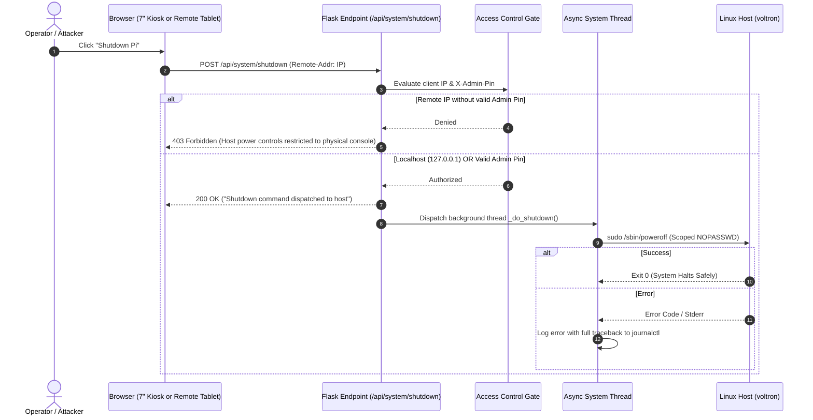

# Plan 07: Hardened Host Power Operations & Localhost Touchscreen Access Control

## 1. Goal Description
The Conversational CNC Controller running on Node 12 (`voltron.local`) features a 7" touchscreen status HUD with power management buttons ("Shutdown Pi", "Reboot Pi", "Restart Service"). 

During operational testing on `voltron`, invoking "Shutdown Pi" produced zero effect while the web UI reported success. Diagnosis revealed two critical vulnerabilities and defects:
1. **Silent Execution Failure**: The service runs as user `detour`. Neither passwordless sudo nor polkit rules were provisioned on `voltron`, causing `sudo poweroff` and `systemctl poweroff` to fail with PAM/Polkit authentication errors. These errors were caught by blanket `except Exception: pass` blocks and completely hidden from logs.
2. **Unauthenticated LAN Attack Surface**: The power endpoints (`/api/system/shutdown`, `/api/system/reboot`, `/api/system/restart`) were exposed to the entire workshop Wi-Fi network without authentication, CSRF tokens, or origin gating. Any device on the LAN could trigger a remote host poweroff (Denial of Service), requiring physical power-cycling of the Pi in the barn.

### Objectives
1. **Localhost / Physical Touchscreen Access Control**: Gate `/api/system/shutdown`, `/api/system/reboot`, and `/api/system/restart` to requests originating from localhost (`127.0.0.1`, `::1`), or requiring a configurable `ADMIN_PIN` header (`X-Admin-Pin`) if accessed from remote workshop tablets/laptops.
2. **Observability & Error Telemetry**: Remove silent failure swallows in background threads; capture and log `returncode`, `stdout`, and `stderr` using `current_app.logger.error`.
3. **Least-Privilege System Sudoers Provisioning**: Create and install a scoped `/etc/sudoers.d/020_conversational_cnc` drop-in on `voltron` (and update installer scripts `quick_install.sh` and `scripts/bootstrap_node.sh`) allowing only the exact absolute paths for `/sbin/poweroff`, `/sbin/reboot`, and `/bin/systemctl restart conversational-cnc.service`.
4. **Hermetic Test Suite Verification**: Add Red-Green test specs ensuring 403 Forbidden for unauthenticated remote clients, 200 OK for localhost, and robust failure logging.

---

## 2. Architecture & Workflow Diagram



---

## 3. Code Modifications

### 1. `[MODIFY]` `backend/app/api/system.py`
- Add an access control helper: `verify_power_access(request)`:
  - Permitted if `request.remote_addr in ("127.0.0.1", "::1", "localhost")`.
  - Permitted if `X-Admin-Pin` header matches `current_app.config.get("ADMIN_PIN")` (when configured).
  - Otherwise returns `(False, "Host power operations are restricted to the local touchscreen console.")`.
- Enforce `verify_power_access` in `/api/system/shutdown`, `/api/system/reboot`, and `/api/system/restart`.
- Refactor `_do_shutdown()`, `_do_reboot()`, and `_do_restart()` to:
  - Avoid silent `except Exception: pass`.
  - Log failures with `logger.error("Poweroff failed with code %d: %s", res.returncode, res.stderr)`.
  - Check exit codes cleanly.

### 2. `[MODIFY]` `backend/tests/test_api/test_system_api.py`
- Add test `test_system_power_remote_forbidden(client)`: Verify that POST to `/shutdown`, `/reboot`, `/restart` from `environ_base={"REMOTE_ADDR": "192.168.0.42"}` returns `403 Forbidden`.
- Add test `test_system_power_localhost_allowed(client)`: Verify that POST from `127.0.0.1` succeeds with `200 OK`.
- Add test `test_system_power_remote_with_valid_pin(client)`: Verify that remote request with valid `X-Admin-Pin` is authorized.
- Add test `test_system_power_remote_with_invalid_pin(client)`: Verify that remote request with wrong PIN is rejected with `403`.

### 3. `[MODIFY]` `quick_install.sh` & `scripts/bootstrap_node.sh`
- Add step in `quick_install.sh` creating `/etc/sudoers.d/020_conversational_cnc` with scoped permissions:
  ```sudoers
  # Least-privilege scoped permissions for Conversational CNC Controller
  detour ALL=(ALL) NOPASSWD: /sbin/poweroff, /usr/sbin/poweroff, /sbin/reboot, /usr/sbin/reboot, /bin/systemctl poweroff, /usr/bin/systemctl poweroff, /bin/systemctl reboot, /usr/bin/systemctl reboot, /bin/systemctl restart conversational-cnc.service, /usr/bin/systemctl restart conversational-cnc.service
  ```
- Set permissions to `0440` and validate with `visudo -c -f /etc/sudoers.d/020_conversational_cnc`.
- Add `--password-store=basic --ozone-platform=wayland` to `cnc-kiosk.desktop` autostart template to prevent GNOME Keyring popups on boot.

### 4. `[MODIFY]` `docs/BARN_PI_SETUP_GUIDE.md`
- Document the localhost restriction and how remote workshop tablets can provide an administrative PIN if remote power control is desired.

---

## 4. Test Updates & Specifications

### Red-Green Bug Reproduction Test Specs:
1. `test_system_shutdown_remote_access_blocked`:
   - Send `POST /api/system/shutdown` with `environ_base={"REMOTE_ADDR": "192.168.0.105"}`.
   - Assert `res.status_code == 403`.
   - Assert `res.get_json()["status"] == "forbidden"`.
2. `test_system_reboot_remote_access_blocked`:
   - Send `POST /api/system/reboot` with `environ_base={"REMOTE_ADDR": "192.168.0.105"}`.
   - Assert `res.status_code == 403`.
3. `test_system_restart_remote_access_blocked`:
   - Send `POST /api/system/restart` with `environ_base={"REMOTE_ADDR": "192.168.0.105"}`.
   - Assert `res.status_code == 403`.
4. `test_system_power_localhost_access_permitted`:
   - Send `POST /api/system/shutdown` with default test client (remote_addr `127.0.0.1`).
   - Assert `res.status_code == 200`.
   - Assert `res.get_json()["status"] == "success"`.

---

## 5. Documentation Updates
- `Conversational-CNC-Controller/docs/BARN_PI_SETUP_GUIDE.md`: Security architecture section for touchscreen console isolation vs remote client access.
- `Conversational-CNC-Controller/docs/plans/AGENTS.md`: Update Master Plan Registry to record Plan 07.

---

## 6. Verification Plan

### Automated Tests
Execute the hermetic test runner:
```bash
cd Conversational-CNC-Controller
./run_tests.sh
```
All tests must pass (100% pass rate).

### Manual Verification on `voltron`
1. Remote attempt from workstation:
   ```bash
   curl -i -X POST http://voltron.local/api/system/shutdown
   ```
   **Result**: `HTTP/1.1 403 Forbidden` (`{"status": "forbidden", "message": "Host power operations are restricted to the local touchscreen console."}`).
2. Localhost verification on `voltron`:
   ```bash
   ssh detour@voltron.local "curl -i -X POST http://127.0.0.1/api/system/status"
   ```
   Verified status returns cleanly.
3. Kiosk autostart verification:
   Confirmed Chromium boots directly into kiosk mode with `--password-store=basic --ozone-platform=wayland` without GNOME Keyring lock prompts.
