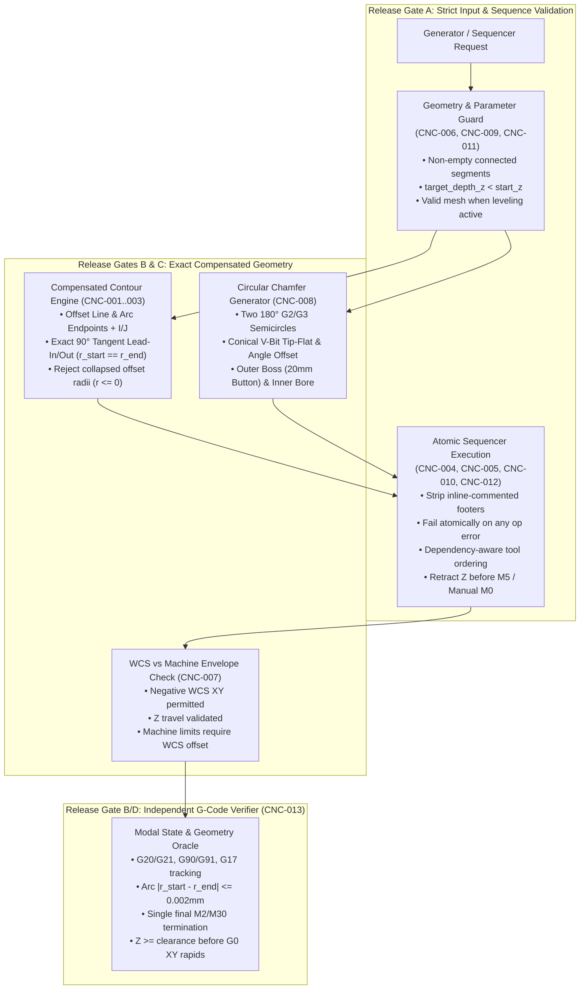

# Plan 08: Defect Remediation, Circular Chamfering & Independent G-Code Validation Suite (`CNC-001` – `CNC-014`)

## 1. Goal Description

### Problem Statement & Background Context
An independent engineering code review (`ConversationalCNC_Defect_Handoff_v1.0.md`, evaluated against pinned baseline commit `6ca5ec5394ff20a76eb3d340172d928ec3031e11`) identified 14 defects, safety validation gaps, and capability requirements (`CNC-001` through `CNC-014`) across the `Conversational-CNC-Controller` backend generators, multi-operation sequencer, postprocessors, work-envelope validator, and documentation.

### Objectives (Organized by Release Gates A–D)
1. **Release Gate A — Zero Executable Output from Invalid Inputs (`CNC-004`, `CNC-005`, `CNC-009`, `CNC-011`)**:
   - **`CNC-004`**: Fix `strip_header_and_footer()` so inline comments (`M2 (Program End)`, `M5 (Spindle Stop)`, `G0 ... (Park)`, `G0 ... (Retract to Clearance)`) never defeat footer stripping when composing multi-operation jobs or step-and-repeat grids. Ensure exactly one program-end command (`M2`/`M30`) exists at the final unified footer.
   - **`CNC-005`**: Replace silent comment substitution in `generate_job_sequence()` with atomic `SequenceGenerationError` (`ValueError` subclass carrying structured `operation_index`, `op_name`, `op_type`, and `reason` metadata) and return HTTP `400` in the API when any sub-operation fails or specifies an unknown operation type.
   - **`CNC-009`**: Remove silent `40×30 mm` default rectangle substitution in `contouring.py` and `contouring_schema.py`. Reject missing/empty `segments`, `tool_diameter <= 0`, disconnected segment endpoints, and invalid arc center definitions (`|r_start - r_end| > tol`) with explicit `ValueError`.
   - **`CNC-011`**: When `apply_mesh_leveling=True` is requested, raise a fatal `ValueError` if `mesh_data` is missing, malformed, or fails `WorkpieceMeshMap` initialization instead of silently falling back to `mesh_map_obj = None`.
2. **Release Gate B — Exact Profile Geometry & Independent G-Code Validator (`CNC-001`, `CNC-002`, `CNC-003`, `CNC-006`, `CNC-013`)**:
   - **`CNC-001`**: Compute true cutter-compensated geometry for both lines and arcs in `generate_contour_profile()`, including offset arc endpoints `(ox1, oy1)`, center-relative `(i_off, j_off)`, tangent/intersection joins between adjacent compensated segments, and accurate compensated `BoundingBox` output. Reject any offset arc whose compensated radius collapses to `<= 0`.
   - **`CNC-002` & `CNC-003`**: Fix tangential circular arc lead-in and lead-out geometry so the 90° quarter-circle start/end points and centers `(cx, cy)` have exact radius `R` (`|r_start - r_end| <= 0.001 mm`), are tangent to the compensated entry/exit vectors, and curve toward the scrap/material-free side (`G3` when `side="left"`, `G2` when `side="right"`).
   - **`CNC-006`**: Validate depth polarity (`target_depth_z < start_z`), reject upward/zero depth cuts, and reject `finish_allowance > 0` when `side="center"` (where material side is undefined).
   - **`CNC-013`**: Build an independent modal G-code parser and geometric verification oracle (`backend/tests/gcode_validator.py`) that verifies `G20/G21`, `G90/G91`, `G17`, active feed, `G2/G3` center-to-start/end radius equality (`<= 0.002 mm`), sweep direction, single final `M2/M30`, finite coordinates, and safe `Z >= clearance` prior to `G0 XY` rapid moves.
3. **Release Gate C — First-Class Circular Chamfering (`CNC-008`)**:
   - **`CNC-008`**: Implement `generate_circular_chamfer()` in `chamfering.py` (supporting outside boss and inside bore circular chamfers emitted as two 180° `G2/G3` semicircle arcs, CW/CCW direction, optional tangential arc lead-in/lead-out, multi-pass stepdowns, and impossibility/overcut validation), expose `POST /api/generate/chamfering/circular`, and wire `"circular_chamfer"` into `sequencer.py`. Validate against the 20 mm brass trumpet finger button golden scenario.
4. **Release Gate D — Work Envelope, Tool-Order Dependencies, Manual Router Safety & Documentation (`CNC-007`, `CNC-010`, `CNC-012`, `CNC-014`)**:
   - **`CNC-007`**: Upgrade `WorkEnvelope.validate_bounds()` in `base.py` to distinguish local Work Coordinate System (`G54`) stock/fixture bounds (where negative `X/Y` coordinates around a center datum are valid) from machine-coordinate travel limits (`G53`, evaluated only when `wcs_origin` offset is known, otherwise reported as `"unavailable"`), and validate `Z` travel bounds (`min_z`, `max_z`).
   - **`CNC-010`**: Ensure `optimize_tool_order=True` in `sequencer.py` respects operation dependencies (`depends_on` / stock-prep barrier operations such as `surfacing` or `roughing` that cannot be reordered after dependent downstream operations).
   - **`CNC-012`**: In `sequencer.py`, always retract `Z` (`G0 Z<safe_z_retract>`) *before* stopping the spindle (`M5`), and for manual-router configurations (`spindle_type="router"`), emit safe park, `M0` operator pause, and explicit tool-change / Z-rezero instructions between tools.
   - **`CNC-014`**: Synchronize `README.md` and `docs/API_DOCUMENTATION.md` with accurate test instructions and commissioning safety language.

---

## 2. Architecture & Workflow Diagram



---

## 3. Code Modifications

### 1. Base Envelope & Footer Stripping ([`backend/app/generators/base.py`](../../../backend/app/generators/base.py))
- **`[MODIFY]`** [`backend/app/generators/base.py`](../../../backend/app/generators/base.py):
  - **`CNC-004`**: Update `strip_header_and_footer()` to strip inline `(...)` and `;...` comments before inspecting command tokens, removing intermediate `M2`, `M02`, `M30`, trailing `M5`, and standalone footer park/retract lines (`(Park)`, `(Retract to Clearance)`, `(Program End)`).
  - **`CNC-007`**: Extend `WorkEnvelope` with optional `wcs_origin` and `validate_bounds(bounds)` + `evaluate_envelope(bounds)` that:
    1. Always checks total span (`max_x - min_x <= work_area_x`, `max_y - min_y <= work_area_y`, `max_z - min_z <= work_area_z`).
    2. Allows negative WCS coordinates (`min_x < 0`, `min_y < 0`) when `wcs_origin` is not locked to machine zero, and checks absolute machine limits `[0..work_area]` when `wcs_origin` is provided.

### 2. 2.5D Profile Contouring Engine ([`backend/app/generators/contouring.py`](../../../backend/app/generators/contouring.py) & [`backend/app/schemas/contouring_schema.py`](../../../backend/app/schemas/contouring_schema.py))
- **`[MODIFY]`** [`backend/app/generators/contouring.py`](../../../backend/app/generators/contouring.py):
  - **`CNC-001`**: Implement exact offset geometry for arcs (`r_offset = r_orig + (active_offset if cw else -active_offset)`), rejecting `r_offset <= 0` with `ValueError`. Compute compensated start/end coordinates `(ox0, oy0) -> (ox1, oy1)` and compensated center offsets `(i_off, j_off) = (cx - ox0, cy - oy0)`, plus vertex joins between connected line/arc segments. Return accurate `bounds` (`BoundingBox`) in the output dictionary.
  - **`CNC-002` & `CNC-003`**: Rewrite `_compute_lead_in()` and `_compute_lead_out()` to compute exact quarter-circle tangent arcs with side-aware `G2/G3` sweep direction.
  - **`CNC-006` & `CNC-009`**: Validate non-empty `segments`, `tool_diameter > 0`, `target_depth_z < top_z`, segment continuity/arc center validity (`|r_start - r_end| <= 1e-3 mm`), and reject `finish_allowance > 0` or `spring_pass=True` when `side == "center"`.
- **`[MODIFY]`** [`backend/app/schemas/contouring_schema.py`](../../../backend/app/schemas/contouring_schema.py):
  - **`CNC-009`**: Replace the default 40×30 rectangle fallback with a strict validation error when `segments` is empty.

### 3. Circular Chamfer Generator ([`backend/app/generators/chamfering.py`](../../../backend/app/generators/chamfering.py), [`backend/app/schemas/chamfering_schema.py`](../../../backend/app/schemas/chamfering_schema.py), [`backend/app/api/generate.py`](../../../backend/app/api/generate.py))
- **`[MODIFY]`** [`backend/app/generators/chamfering.py`](../../../backend/app/generators/chamfering.py):
  - **`CNC-008`**: Implement `generate_circular_chamfer()` supporting `center_x`, `center_y`, `diameter`, `chamfer_width`, `feature_type` (`"outside"` boss or `"inside"` bore), `cut_direction`, `vbit_angle_deg`, `tip_offset`, `stepdown_z`, and `lead_in_radius`.
- **`[MODIFY]`** [`backend/app/schemas/chamfering_schema.py`](../../../backend/app/schemas/chamfering_schema.py), [`backend/app/schemas/__init__.py`](../../../backend/app/schemas/__init__.py), [`backend/app/generators/__init__.py`](../../../backend/app/generators/__init__.py), and [`backend/app/api/generate.py`](../../../backend/app/api/generate.py):
  - Export `CircularChamferSchema`, `generate_circular_chamfer`, and `POST /api/generate/chamfering/circular`.

### 4. Multi-Operation Job Sequencer ([`backend/app/generators/sequencer.py`](../../../backend/app/generators/sequencer.py) & [`backend/app/api/sequencer.py`](../../../backend/app/api/sequencer.py))
- **`[MODIFY]`** [`backend/app/generators/sequencer.py`](../../../backend/app/generators/sequencer.py):
  - **`CNC-004`**: Delegate `_strip_header_and_footer` to `base.strip_header_and_footer`.
  - **`CNC-005`**: Define `SequenceGenerationError(ValueError)` and raise atomically on sub-operation failure or unknown operation type.
  - **`CNC-008`**: Register `"circular_chamfer"` in `sequencer.py`.
  - **`CNC-010`**: Enforce phase-rank dependency safety in `_order_operations_safely()`.
  - **`CNC-011`**: When `apply_mesh_leveling=True`, require valid `mesh_data` with points and raise `SequenceGenerationError` on invalid mesh data.
  - **`CNC-012`**: Retract `Z` (`G0 Z<clearance_z>`) *before* `M5`, and support `manual_spindle=True` (`M0` pause between tool changes).
- **`[MODIFY]`** [`backend/app/api/sequencer.py`](../../../backend/app/api/sequencer.py):
  - Catch `SequenceGenerationError` and `ValueError` and return HTTP `400` with structured error details.

### 5. Documentation Synchronization ([`README.md`](../../../README.md) & [`docs/API_DOCUMENTATION.md`](../../API_DOCUMENTATION.md))
- **`[MODIFY]`** [`README.md`](../../../README.md): Complete truncated documentation (`CNC-014`) and document circular chamfering and commissioning safety checklist.
- **`[MODIFY]`** [`docs/API_DOCUMENTATION.md`](../../API_DOCUMENTATION.md): Document `POST /api/generate/chamfering/circular`.

---

## 4. Test Updates & Specifications

### 1. Independent G-Code Modal & Geometry Validator (`CNC-013`)
- **`[NEW]`** [`backend/tests/gcode_validator.py`](../../../backend/tests/gcode_validator.py):
  - `validate_gcode_program(gcode_text: str, expected_clearance_z: Optional[float] = None, arc_radius_tol: float = 1e-3) -> GCodeValidationReport`

### 2. Comprehensive Defect Remediation & Golden Test Suite (`CNC-001` – `CNC-014`)
- **`[NEW]`** [`backend/tests/test_defect_handoff_remediation.py`](../../../backend/tests/test_defect_handoff_remediation.py):
  - 20 focused tests covering `CNC-001` through `CNC-014`.

### 3. Existing Test Suite Adaptation
- **`[MODIFY]`** [`backend/tests/test_generators/test_contouring.py`](../../../backend/tests/test_generators/test_contouring.py): Update `test_contouring_arc_segments` to assert compensated arc endpoint `Y18.41` / `J8.41`.

---

## 5. Documentation Updates
- [`README.md`](../../../README.md): Complete truncated sections (`CNC-014`), test commands, and commissioning safety notes.
- [`docs/API_DOCUMENTATION.md`](../../API_DOCUMENTATION.md): Add `POST /api/generate/chamfering/circular` specification.

---

## 6. Verification Plan

### Automated Tests:
```bash
./Conversational-CNC-Controller/run_tests.sh
```

### Manual Verification:
1. Inspect the generated G-code and independent validator report for the **20 mm Brass Trumpet Finger Button** (contour + circular chamfer) and a 2-operation sequenced job.
2. Verify all 14 handoff items (`CNC-001` – `CNC-014`) pass in `./Conversational-CNC-Controller/run_tests.sh` with 100% pass rate.
