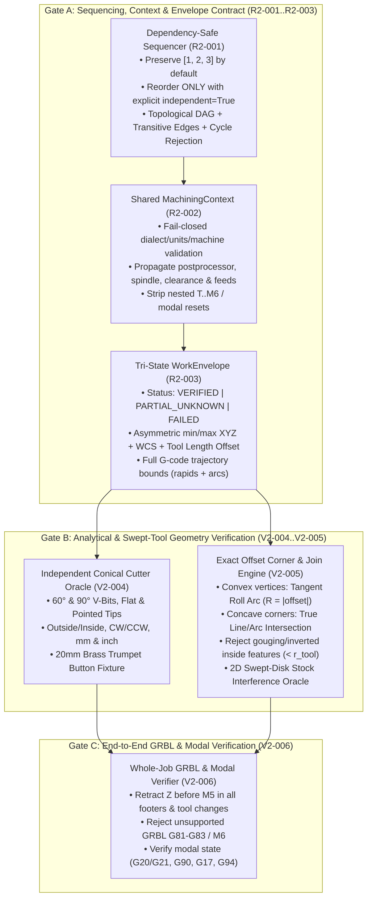

# Plan 09: Remediation Handoff v2.0 — Dependency-Safe Sequencing, MachiningContext Propagation, Envelope Contract & Swept Geometry Verification (`R2-001` – `V2-006`)

## 1. Goal Description

### Problem Statement & Background Context
Following the completion of **Plan 08** (commit `277e592`), the follow-up engineering review [`Temp/ConversationalCNC_Remediation_Handoff_v2.0.md`](../../../../Temp/ConversationalCNC_Remediation_Handoff_v2.0.md) identified three high/medium-priority architectural integration risks (`R2-001`, `R2-002`, `R2-003`) and three pre-commissioning numerical/geometric verification gates (`V2-004`, `V2-005`, `V2-006`) required before physical air-cuts or machining brass parts on `voltron.local`:

1. **`R2-001` (High — Tool Optimization & Operation Dependencies)**:
   - Previously, `_order_operations_safely()` in [`backend/app/generators/sequencer.py`](../../../backend/app/generators/sequencer.py) grouped all non-barrier operations by tool number when `optimize_tool_order=True`. Given a 3-step job without explicit dependencies (`Op 1: T1 drill` $\rightarrow$ `Op 2: T2 pocket` $\rightarrow$ `Op 3: T1 finish inside pocket`), it reordered the sequence to `[1, 3, 2]`, executing the finishing pass before the pocket was excavated.
   - Furthermore, explicit `depends_on` edges were not validated as a Directed Acyclic Graph (DAG) with transitive dependency preservation and cycle rejection.
2. **`R2-002` (High — Shared `MachiningContext` & Fail-Closed Dialect/Machine Propagation)**:
   - Previously, [`backend/app/postprocessors/registry.py`](../../../backend/app/postprocessors/registry.py) silently fell back to `GrblPostProcessor` when given an unknown dialect, and [`backend/app/generators/sequencer.py`](../../../backend/app/generators/sequencer.py) did not propagate `MachiningContext` (`dialect`, `units`, `spindle_control_type`, `safe_z`, `envelope`) uniformly across all generators (`drilling`, `pockets`, `slotting`, `chamfering`, `thread_milling`, `surfacing`, `contouring`, `engraving`).
   - Additionally, `StandardPostProcessor` emitted `T<n> M6` inside sub-generator headers that `strip_header_and_footer()` did not strip, causing nested `M6` tool changes in multi-operation sequences.
3. **`R2-003` (Medium/High — Explicit Tri-State Work-Envelope Contract & Asymmetric Z Limits)**:
   - Previously, `WorkEnvelope` in [`backend/app/generators/base.py`](../../../backend/app/generators/base.py) assumed symmetric Z travel (`[-work_area_z, +work_area_z]`), ignored `wcs_origin_z` and `tool_length_offset`, and did not distinguish `VERIFIED`, `PARTIAL_UNKNOWN`, and `FAILED` states or compute envelope bounds over full G-code rapid/retract/arc trajectories.
4. **`V2-004` (Verification — Independent Circular Chamfer Cutter-Contact Math)**:
   - Required an independent analytical cone-workpiece intersection oracle verifying `generate_circular_chamfer()` across outside/inside features, CW/CCW directions, `60°` and `90°` included angles, pointed (`tip_diameter=0.0`) and flat-tip (`tip_diameter > 0`) V-bits, metric (`mm`) and imperial (`inch`) units, and the **20 mm Brass Trumpet Finger Button** fixture.
5. **`V2-005` (Verification — Offset Contour Joins, Concave Corners & 2D Swept-Tool Interference)**:
   - Previously, [`backend/app/generators/contouring.py`](../../../backend/app/generators/contouring.py) connected non-tangent line-to-arc and arc-to-arc offset transitions with a straight `G1` chord bridge, which gouged convex corners (`distance < r_tool`) and did not reject self-inverting concave steps when a feature was smaller than the tool radius.
6. **`V2-006` (Verification — Whole-Job GRBL Dialect, Modal Consistency & Retract-Before-Stop)**:
   - In [`backend/app/postprocessors/grbl.py`](../../../backend/app/postprocessors/grbl.py), `format_footer()` emitted `M5` before `G0 Z<park_z>`, stopping the spindle before retracting to safe Z clearance. Whole-job GRBL validation needed to enforce single final program termination, retract-before-`M5`, unsupported GRBL command rejection (`G81`–`G83`, `M6`), and full interpolated path bounds.

---

## 2. Architecture & Workflow Diagram



---

## 3. Code Modifications

### 1. Base Envelope Contract, Full Trajectory Bounds & `MachiningContext` ([`backend/app/generators/base.py`](../../../backend/app/generators/base.py))
- **`[MODIFY]`** [`backend/app/generators/base.py`](../../../backend/app/generators/base.py):
  - **`R2-002`**: Added `@dataclass class MachiningContext` and `normalize_units()`.
  - **`R2-003`**: Upgraded `WorkEnvelope` with `min_x/max_x`, `min_y/max_y`, `min_z/max_z`, `wcs_origin_x/y/z`, `tool_length_offset`, `strict_mode`, `compute_gcode_bounds()`, and tri-state `status`: `VERIFIED`, `PARTIAL_UNKNOWN`, or `FAILED`.
  - **`R2-002`**: Updated `strip_header_and_footer()` to strip sub-operation tool-change lines (`T<n> M6` / `M6 T<n>`).

### 2. Postprocessor Fail-Closed Dialect Lookup & Retract-Before-Stop ([`backend/app/postprocessors/registry.py`](../../../backend/app/postprocessors/registry.py) & [`backend/app/postprocessors/grbl.py`](../../../backend/app/postprocessors/grbl.py))
- **`[MODIFY]`** [`backend/app/postprocessors/registry.py`](../../../backend/app/postprocessors/registry.py):
  - **`R2-002`**: `get_postprocessor(dialect_name)` raises `ValueError` on unknown dialects instead of silently defaulting to `GrblPostProcessor`.
- **`[MODIFY]`** [`backend/app/postprocessors/grbl.py`](../../../backend/app/postprocessors/grbl.py):
  - **`V2-006`**: `GrblPostProcessor.format_footer()` emits `G0 Z<park_z> (Retract to Clearance)` **before** `M5 (Spindle Stop)`.

### 3. Dependency-Safe Sequencer & Context Propagation ([`backend/app/generators/sequencer.py`](../../../backend/app/generators/sequencer.py))
- **`[MODIFY]`** [`backend/app/generators/sequencer.py`](../../../backend/app/generators/sequencer.py):
  - **`R2-001`**: Implemented `_order_operations_with_trace()` preserving authored order `[1, 2, 3]` unless `independent=True`, validating DAG `depends_on` edges, rejecting cycles/unknown IDs, and returning `summary.optimization_trace`.
  - **`R2-002`**: Propagated `MachiningContext` to all sub-generators.

### 4. Circular Chamfer Unit & Dialect Support ([`backend/app/generators/chamfering.py`](../../../backend/app/generators/chamfering.py))
- **`[MODIFY]`** [`backend/app/generators/chamfering.py`](../../../backend/app/generators/chamfering.py):
  - **`V2-004`**: Added `units` (`mm`/`inch`), `dialect` resolution, unit-scaled lead-in clearance, and inside-bore radius collapse guard (`chamfer_width + radial_offset >= nom_r`).

### 5. Exact Offset Contour Joins & Stock-Interference Protection ([`backend/app/generators/contouring.py`](../../../backend/app/generators/contouring.py))
- **`[MODIFY]`** [`backend/app/generators/contouring.py`](../../../backend/app/generators/contouring.py):
  - **`V2-005`**: Replaced straight `G1` bridges at convex non-tangent transitions with tangent corner-roll arcs (`G2`/`G3`) of radius `|active_offset|` centered at the nominal vertex $V = (vx, vy)$. Tracked un-mutated segment origins (`orig_ox0`, `orig_oy0`, `t_start`, `t_end`) to detect and reject concave segment inversions with `ValueError`.

---

## 4. Test Updates & Specifications

- **`[MODIFY]`** [`backend/tests/gcode_validator.py`](../../../backend/tests/gcode_validator.py)
- **`[NEW]`** [`backend/tests/test_remediation_handoff_v2.py`](../../../backend/tests/test_remediation_handoff_v2.py) (`61` test items across `R2-001`–`V2-006`)

---

## 5. Documentation Updates
- [`docs/API_DOCUMENTATION.md`](../../API_DOCUMENTATION.md)
- [`README.md`](../../../README.md)

---

## 6. Verification Plan

### Automated Tests:
```bash
./Conversational-CNC-Controller/run_tests.sh backend/tests/test_remediation_handoff_v2.py -v
./Conversational-CNC-Controller/run_tests.sh
```

### Manual Verification:
1. Reviewed the disposition table, before/after toolpath G-code samples (`R2-001`, `R2-002`, `V2-004`, `V2-005`), and the multi-operation **20 mm Brass Trumpet Finger Button** job validated by `validate_gcode()` and `verify_contour_no_stock_gouge()`.
2. Confirmed 100% pass rate across the entire hermetic test suite (`289 passed in 1.70s`).
