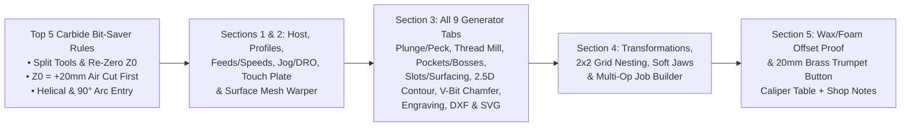

# Plan 10: Workshop CNC Software Feature Exerciser, Bit-Saver Checklist & Printable 2-Page PDF

## 1. Goal Description

### Problem Statement & Background Context
Because the physical X-Carve CNC machine has been in operation for over a decade, the workshop checklist does not need hardware build commissioning or multi-person sign-off blocks. Instead, it needs a practical, single-sheet (2-page front/back) **Software Feature Exerciser & Carbide Bit-Saver Checklist** that walks through 100% of the **Conversational CNC Controller (`voltron.local`)** generators, probing macros, transformations, and multi-operation sequencer features to ensure safe toolpath generation and prevent breaking expensive carbide bits.

---

## 2. Architecture & Workflow Diagram

---

## 3. Code Modifications

### 1. Printable PDF Generator Script ([`scripts/generate_commissioning_pdf.py`](../../../scripts/generate_commissioning_pdf.py))
- **`[NEW]`** [`scripts/generate_commissioning_pdf.py`](../../../scripts/generate_commissioning_pdf.py):
  - Uses Typst (`/opt/homebrew/bin/typst`) to compile the 2-page US-Letter printable PDF [`docs/Workshop_CNC_Commissioning_Checklist.pdf`](../../Workshop_CNC_Commissioning_Checklist.pdf).

---

## 4. Test Updates & Specifications
- *None required* (Pure documentation and printable PDF generation under Invariant 14).

---

## 5. Documentation Updates
- **`[MODIFY]`** [`docs/MACHINE_INTEGRATION_TEST_PLAN.md`](../../MACHINE_INTEGRATION_TEST_PLAN.md)
- **`[NEW]`** [`docs/Workshop_CNC_Commissioning_Checklist.pdf`](../../Workshop_CNC_Commissioning_Checklist.pdf)

---

## 6. Verification Plan
- Verified 2-page US-Letter PDF layout (`180,152 bytes`) and updated Markdown checklist with user validation.
