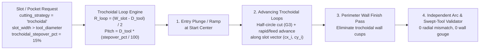

# Plan 13: Adaptive Trochoidal Clearing for Slotting & Pocketing

## 1. Goal Description

### Problem Statement & Context
Currently, `generate_linear_slot()` in [`backend/app/generators/slotting.py`](../../backend/app/generators/slotting.py) (as well as the initial opening cut of [`backend/app/generators/rectangular_pocket.py`](../../backend/app/generators/rectangular_pocket.py)) plunges and plows straight down the slot centerline at **100% radial cutter engagement**, and no circular arc-slot generator (`generate_arc_slot()`) exists yet.

On workshop gantry CNCs (such as the X-Carve or leadscrew routers) cutting **brass, aluminum, or dense hardwood**:
- 100% radial engagement causes severe tool deflection, chatter, heat buildup, and chip recutting, frequently snapping small-diameter endmills (e.g. $1/8"$ / $3.175\text{ mm}$ or $1/16"$).
- Operators are forced to take ultra-shallow axial stepdowns ($0.2\text{--}0.4\text{ mm}$), which concentrates wear on the very tip of the flutes.

**Trochoidal ("Peel") Milling** solves this deterministically by replacing a full-width linear plow with a continuous series of overlapping circular arcs (`G3` climb-milling trochoidal loops) advancing along the slot centerline by a controlled radial stepover ($w_e$, typically $10\%\text{--}20\%$ of tool diameter).

### Objectives
1. **Deterministic Trochoidal Slotting Generator (`backend/app/generators/slotting.py`)**:
   - Add `cutting_strategy: Literal["conventional", "trochoidal"] = "conventional"` and `trochoidal_stepover_pct: float = 15.0` (percentage of tool diameter, $5\%\text{--}40\%$) to `generate_linear_slot()` and [`backend/app/schemas/slotting_schema.py`](../../backend/app/schemas/slotting_schema.py) (`LinearSlotPayloadSchema`).
   - Implement `generate_arc_slot()` (with `ArcSlotPayloadSchema`, `POST /api/generate/slotting/arc`, and `sequencer.py` `"arc_slot"` registration) supporting both `"conventional"` and `"trochoidal"` strategies.
   - When `cutting_strategy == "trochoidal"` and `slot_width >= tool_diameter * 1.05`:
     - Compute the trochoidal loop radius $R_{\text{loop}} = \frac{\text{slot\_width} - \text{tool\_diameter}}{2}$ and forward pitch per loop $p = \text{tool\_diameter} \times \frac{\text{trochoidal\_stepover\_pct}}{100}$ (for arc slots, scale centerline angular step $\Delta\theta$ by $\frac{R_{\text{center}}}{R_{\text{center}} + R_{\text{loop}}}$ so outer-wall radial engagement never exceeds `trochoidal_stepover_pct`).
     - Emit a helical or linear Z-ramp entry at `plunge_feed` into the first loop $C_0$, execute full `G3` climb-milling circular loops with inward centerline retract/repositioning between loops (zero wall-gouging bridge arcs), and finish each Z-depth with a continuous CCW `G3` perimeter cleanup pass along both walls and semicircular end-caps.
2. **Trochoidal Core-Opening Option for Rectangular Pockets (`backend/app/generators/rectangular_pocket.py`)**:
   - Add `trochoidal_entry: bool = False` and `trochoidal_stepover_pct: float = 15.0` ($5\%\text{--}40\%$) to `RectangularPocketPayloadSchema` and `generate_rectangular_pocket()` so the central spine (X-axis when `length_x >= width_y`, Y-axis when `width_y > length_x`) is opened with a trochoidal slot pass before spiraling outward at the target radial stepover.
3. **API, Sequencer & Web UI Integration**:
   - Forward trochoidal parameters in [`backend/app/api/generate.py`](../../backend/app/api/generate.py) (`generate_linear_slot_gcode`, `generate_arc_slot_gcode`, `generate_rectangular_pocket_gcode`) and [`backend/app/generators/sequencer.py`](../../backend/app/generators/sequencer.py).
   - Expose **Trochoidal Core Entry** and **Trochoidal Stepover %** in [`backend/app/templates/operations/rectangular_pocket.html`](../../backend/app/templates/operations/rectangular_pocket.html) and [`backend/app/static/js/rectangular_pocket.js`](../../backend/app/static/js/rectangular_pocket.js) (direct + Job Builder payloads, hidden in `boss` mode). Slotting (`linear_slot` / `arc_slot`) is REST API + Job Sequencer only in Plan 13 (no standalone `/slotting` HTML page exists yet).
4. **Swept-Geometry & Independent G-Code Validator Verification (`backend/tests/gcode_validator.py`)**:
   - Add `verify_swept_slot_containment(...)` and `verify_swept_pocket_containment(...)` independent geometric oracles in [`backend/tests/gcode_validator.py`](../../backend/tests/gcode_validator.py) to verify 100% of generated trochoidal `G2`/`G3` arcs satisfy strict endpoint radius matching ($\le 0.002\text{ mm}$ radial error), stay strictly inside the declared slot/pocket capsule/rectangle boundary (zero wall overcut/gouge), and pass `WorkEnvelope` bounds verification.

---

## 2. Architecture & Workflow Diagram



---

## 3. Code Modifications

### Component 1: Trochoidal Slotting Schema & Generator (`slotting_schema.py`, `slotting.py`, `sequencer.py`)
- **`[MODIFY]`** [`backend/app/schemas/slotting_schema.py`](../../backend/app/schemas/slotting_schema.py) & [`backend/app/schemas/__init__.py`](../../backend/app/schemas/__init__.py):
  - Add `cutting_strategy: Literal["conventional", "trochoidal"] = "conventional"` and `trochoidal_stepover_pct: float = Field(default=15.0, ge=5.0, le=40.0)` to `LinearSlotPayloadSchema`.
  - Add `ArcSlotPayloadSchema` (`center_x`, `center_y`, `radius`, `start_angle_deg`, `end_angle_deg`, `slot_width`, `target_depth_z`, `tool_diameter`, `stepdown_z`, `start_z`, `retract_z`, `feed_rate_xy`, `plunge_feed`, `rapid_feed`, `spindle_speed`, `spindle_dwell_seconds`, `units`, `tool_id`, `material_preset_id`, `machine_profile_id`, `spindle_type`, `router_model`, `router_dial`, `cutting_strategy`, `trochoidal_stepover_pct`) and export it from `schemas/__init__.py`.
- **`[MODIFY]`** [`backend/app/generators/slotting.py`](../../backend/app/generators/slotting.py) & [`backend/app/generators/__init__.py`](../../backend/app/generators/__init__.py):
  - Update `generate_linear_slot(..., cutting_strategy: str = "conventional", trochoidal_stepover_pct: float = 15.0, require_pause: bool = True, rapid_feed: Optional[float] = None)` and implement `generate_arc_slot(...)` (exporting it from `generators/__init__.py`).
  - **Generator-Level Validation**: Inside both `generate_linear_slot()` and `generate_arc_slot()`, validate `cutting_strategy in ("conventional", "trochoidal")`, `5.0 <= trochoidal_stepover_pct <= 40.0`, and when `cutting_strategy == "trochoidal"`, require `slot_width >= tool_diameter * 1.05` (raising `ValueError("Trochoidal clearing requires slot_width >= 1.05 * tool_diameter so the cutter can orbit safely.")`). Doing this inside the generators guarantees `tool_id`-resolved diameters from `_resolve_context` are validated identically to explicit `tool_diameter`.
  - **Trochoidal Loop Kinematics (Zero-Gouge & Precision Safe)**:
    - Entry at first loop center $C_0$: helical Z-ramp (when $R_{\text{loop}} \ge 0.25\text{ mm}$) or linear Z-ramp along the slot centerline at `plunge_feed` (never a 100%-engagement vertical plunge in trochoidal mode).
    - Loop emission: full `G3` climb-milling circle of radius $R_{\text{loop}} = (\text{slot\_width} - \text{tool\_diameter}) / 2.0$ around $C_k$, followed by an inward retract chord/arc inside the already-cleared core back to the centerline, feed advance to $C_{k+1}$'s entry point, and tangent lead-in to $C_{k+1}$ (eliminating wall-gouging bridge arcs).
    - Precision & GRBL Safety: round all `(x, y)` coordinates to 4 decimal places (`round(val, 4)`) and compute `I, J` offsets directly from the **rounded start coordinate** (`center - rounded_start`) so `|r_start - r_end| <= 0.002 mm`; skip degenerate arc segments with chord `< 0.001 mm` (avoiding `visualizer.js` full-circle rendering artifacts).
    - Perimeter cleanup: finish each Z-depth with a continuous CCW (`G3` climb) boundary pass along both side walls and semicircular end-caps (capsule).
    - Arc-slot pitch scaling: step $C_k$ along `radius` with angular pitch $\Delta\theta = \frac{p}{R_{\text{center}}} \times \frac{R_{\text{center}}}{R_{\text{center}} + R_{\text{loop}}}$ so outer-wall radial engagement never exceeds `trochoidal_stepover_pct`.
    - `WorkEnvelope` & Backward Compatibility: preserve exact conventional `generate_linear_slot` `BoundingBox` behavior so existing conventional tests (`bounds.min_x == 10.0, max_x == 60.0`) remain unchanged; in trochoidal mode, compute full capsule/arc excursion bounds (`± R_loop`) and call `work_envelope.validate_bounds(bounds)`.
    - Use `postprocessor.format_*`, `require_pause`, and `strip_header_and_footer`-compatible header/footer blocks.
- **`[MODIFY]`** [`backend/app/generators/sequencer.py`](../../backend/app/generators/sequencer.py):
  - Import and register `"arc_slot": generate_arc_slot` in `OPERATION_GENERATORS`.

### Component 2: Rectangular Pocket Trochoidal Core Entry (`pocket_schema.py` & `rectangular_pocket.py`)
- **`[MODIFY]`** [`backend/app/schemas/pocket_schema.py`](../../backend/app/schemas/pocket_schema.py):
  - Add optional `trochoidal_entry: bool = False` and `trochoidal_stepover_pct: float = Field(default=15.0, ge=5.0, le=40.0)` to `RectangularPocketPayloadSchema`.
- **`[MODIFY]`** [`backend/app/generators/rectangular_pocket.py`](../../backend/app/generators/rectangular_pocket.py):
  - Add `trochoidal_entry: bool = False` and `trochoidal_stepover_pct: float = 15.0` to `generate_rectangular_pocket(...)`.
  - When `trochoidal_entry=True`, determine the central spine orientation (`X`-axis when `length_x >= width_y`, `Y`-axis when `width_y > length_x`, including square pockets `length_x == width_y`), open the central core channel using the trochoidal loop helper before executing outward constant-engagement offset rings, and handle narrow pockets (`min(length_x, width_y) <= tool_diameter * 1.05`) by raising `ValueError` or gracefully skipping trochoidal orbit when width is insufficient (consistent with `finish_pass_allowance`).

### Component 3: REST API Forwarding & Pocketing Web UI Controls (`generate.py`, `rectangular_pocket.html`, `rectangular_pocket.js`)
- **`[MODIFY]`** [`backend/app/api/generate.py`](../../backend/app/api/generate.py):
  - In `generate_linear_slot_gcode()`: forward `cutting_strategy=payload.cutting_strategy` and `trochoidal_stepover_pct=payload.trochoidal_stepover_pct` to `generate_linear_slot(...)`.
  - Add `@generate_bp.route("/slotting/arc", methods=["POST"])` (`generate_arc_slot_gcode()`) validating `ArcSlotPayloadSchema`, resolving context via `_resolve_context(payload)`, and invoking `generate_arc_slot(...)` (returning HTTP `400` on `ValueError`).
  - In `generate_rectangular_pocket_gcode()`: forward `trochoidal_entry=payload.trochoidal_entry` and `trochoidal_stepover_pct=payload.trochoidal_stepover_pct` to `generate_rectangular_pocket(...)`.
- **`[MODIFY]`** [`backend/app/templates/operations/rectangular_pocket.html`](../../backend/app/templates/operations/rectangular_pocket.html) & [`backend/app/static/js/rectangular_pocket.js`](../../backend/app/static/js/rectangular_pocket.js):
  - Expose **Trochoidal Core Entry (Low-Chatter Metal/Hardwood Mode)** checkbox (`trochoidal_entry`) and **Trochoidal Stepover %** numeric input (`trochoidal_stepover_pct`, min `5`, max `40`, default `15`).
  - Wire both fields into the direct `/api/generate/pocket/rectangular` request payload AND the Job Builder queue `opPayload.params`, and hide/disable the controls when `boss` mode is selected.
  - *Scope Note*: Slotting (`linear_slot` / `arc_slot`) has no standalone `/slotting` HTML page in the current UI; Plan 13 delivers backend generators, REST API endpoints, and Job Sequencer support for slotting.

### Component 4: Independent Swept-Containment Validator (`gcode_validator.py`)
- **`[MODIFY]`** [`backend/tests/gcode_validator.py`](../../backend/tests/gcode_validator.py):
  - Add `verify_swept_slot_containment(...)` (for linear capsule slots and circular arc slots) and `verify_swept_pocket_containment(...)` (for rectangular pockets) sampling all `G1`/`G2`/`G3` cutting moves and asserting every swept disk point (`center ± tool_diameter / 2`) remains within the declared boundary plus rounding tolerance (`<= 0.01 mm`).

---

## 4. Test Updates & Specifications

- **`[NEW]`** `backend/tests/test_generators/test_trochoidal_clearing.py`:
  1. `test_linear_slot_trochoidal_arc_validity_and_non_gouge()`:
     - Generates a $25\text{ mm}$ long, $6.0\text{ mm}$ wide slot with a $3.175\text{ mm}$ ($1/8"$) endmill at `trochoidal_stepover_pct=15.0`.
     - Runs `validate_gcode_program(..., arc_tol=0.002, expected_clearance_z=..., dialect="grbl")` AND `verify_swept_slot_containment(...)`, asserting zero arc mismatches, helical/ramped entry (no vertical centerline plunge), CCW `G3` cleanup pass, and 100% swept containment within the $6.0\text{ mm}$ capsule walls.
  2. `test_arc_slot_trochoidal_and_conventional()`:
     - Tests `generate_arc_slot()` in both `"conventional"` and `"trochoidal"` modes, verifying outer-wall angular pitch scaling, `|r_start - r_end| <= 0.002 mm`, and `verify_swept_slot_containment(...)` on curved slot boundaries.
  3. `test_trochoidal_rejects_narrow_slot_and_invalid_stepover()`:
     - Verifies `cutting_strategy="trochoidal"` when `slot_width == tool_diameter` (or `< 1.05 * tool_diameter`) raises `ValueError` in both `generate_linear_slot()` and `generate_arc_slot()`, and stepover outside `5.0..40.0` fails validation.
  4. `test_api_trochoidal_endpoints_and_tool_id_validation()`:
     - Exercises `POST /api/generate/slotting/linear`, `POST /api/generate/slotting/arc`, and `POST /api/generate/pocket/rectangular` via Flask test client, including `tool_id`-resolved `tool_diameter` triggering HTTP `400` when `slot_width < 1.05 * tool_diameter`.
  5. `test_rectangular_pocket_trochoidal_orientations_and_sequencer()`:
     - Tests `trochoidal_entry=True` on horizontal (`40x25 mm`), vertical (`25x40 mm`, `width_y > length_x`), square (`30x30 mm`), and narrow pockets, plus multi-op `sequencer.py` composition (`linear_slot` + `arc_slot` + `rectangular_pocket`) verifying `strip_header_and_footer` and `WorkEnvelope` bounds enforcement.
  6. `test_conventional_slotting_backward_compatibility()`:
     - Confirms default `cutting_strategy="conventional"` emits the exact legacy centerline pass and `BoundingBox` bounds (`test_slotting_chamfering.py` contract).

---

## 5. Documentation Updates

- **`[MODIFY]`** [`docs/MACHINE_INTEGRATION_TEST_PLAN.md`](../MACHINE_INTEGRATION_TEST_PLAN.md):
  - Add Trochoidal Slotting / Pocketing verification case for brass and aluminum.

---

## 6. Verification Plan

### Automated Tests
```bash
./Conversational-CNC-Controller/run_tests.sh
```

### Manual Verification
1. Open `http://voltron.local`, select **Rectangular Pocket** with a $1/8"$ ($3.175\text{ mm}$) endmill, enable **Trochoidal Core Entry**, set stepover to `15%`, and preview the toolpath in the 2D/3D visualizer to confirm smooth overlapping `G3` loops, outward offset rings, and zero full-circle arc glitches.
2. Verify switching to **Boss** mode hides/disables the Trochoidal Core Entry control, and queueing a Pocket operation in **Job Builder** preserves `trochoidal_entry` and `trochoidal_stepover_pct` in the job parameters.
3. Verify `POST /api/generate/slotting/linear` and `POST /api/generate/slotting/arc` return valid GRBL G-code with `cutting_strategy="trochoidal"` and return HTTP `400` when `slot_width <= tool_diameter`.

---

## Supervisor Sign-off

- **Gate A Plan Supervisor Review**: Completed (`pro` model, 2026-11-20).
- **Resolved Findings (`Gate A: PASS`)**:
  1. Aligned schema/generator names (`LinearSlotPayloadSchema`, `RectangularPocketPayloadSchema`) and explicitly specified `ArcSlotPayloadSchema`, `generate_arc_slot()`, `POST /api/generate/slotting/arc`, and `sequencer.py` `"arc_slot"` registration.
  2. Added `backend/app/api/generate.py` parameter forwarding (`cutting_strategy`, `trochoidal_stepover_pct`, `trochoidal_entry`) and scoped Component 3 UI to `rectangular_pocket.html` / `rectangular_pocket.js` (direct + Job Builder + `boss` mode hiding).
  3. Reconciled `trochoidal_stepover_pct` to `5.0..40.0`, specified helical/linear Z-ramp entry, inward-retract loop transitions, 4-decimal `I/J` precision from rounded start, `< 0.001 mm` chord skip, CCW `G3` cleanup pass, arc-slot outer-wall pitch scaling, `width_y > length_x` / square / narrow pocket handling, `WorkEnvelope` bounds preservation for conventional mode, and generator-level `ValueError` validation for `tool_id`-resolved diameters.
  4. Added `verify_swept_slot_containment` / `verify_swept_pocket_containment` in `backend/tests/gcode_validator.py` and expanded `backend/tests/test_generators/test_trochoidal_clearing.py` to cover all API, sequencer, orientation, and backward-compatibility cases.
